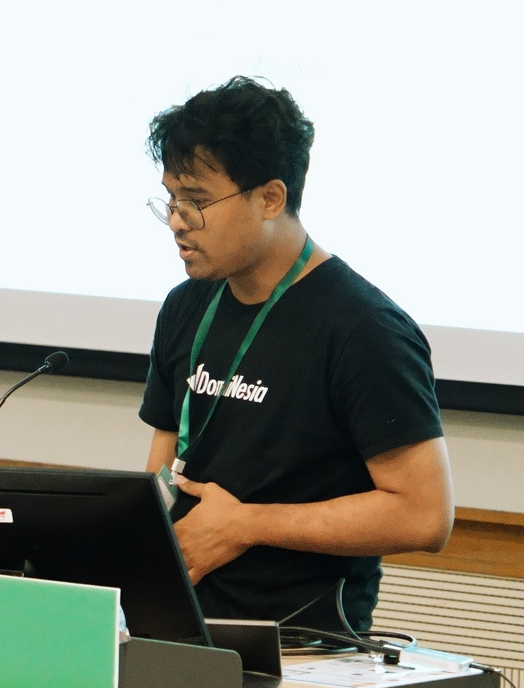
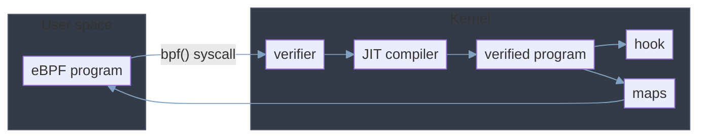
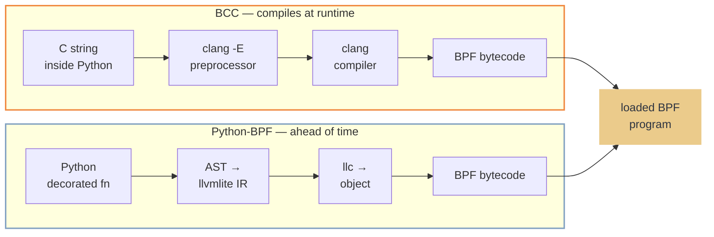

# Python eBPF: BCC C-String Runtime vs Python-BPF AST AOT

Nizar Akbar Meilani — DomaiNesia

PyCon Taiwan 2026

<!--
Welcome. Today we compare two Python eBPF frameworks — not just which is faster, but WHY. We measured every layer: startup syscalls, per-event CPU, memory, profiling, bytecode, JIT instructions. Both frameworks load a BPF program into the kernel — every performance difference lives in the userspace glue around it.
-->

---
layout: two-cols
---

# About Me

::left::

Systems engineer at **DomaiNesia** · Yogyakarta, Indonesia

- **Focus:** eBPF from Python — kernel observability without writing C
- **Recently:** Python wrappers for traffic filtering — utilizing **bpfilter**
- **Today:** PyCon Taiwan 2026 · previously PyCon APAC 2024 · PyCon HK 2025 · PyCon ID 2025

::right::



<div class="text-[17px] mt-5 space-y-2 break-all leading-snug">

https://github.com/nizarakbar

https://github.com/nizarakbarm/pycon-tw-2026-bcc-vs-pythonbpf

</div>

<!--
Quick intro. I'm a systems engineer at DomaiNesia — a hosting and cloud provider in Indonesia — building Python tooling for eBPF observability. My approach is data over assumptions, shaped by CTF reverse engineering. This talk is that approach applied to eBPF tooling.
-->

---
layout: default
---

# eBPF architecture overview



<!--
This is the frame for everything that follows. Two boxes: user space and kernel. Both tools sit in the first box, and both use one path in the second box: the same bpf() syscall, the same verifier, the same JIT compiler, the same hook, the same maps. The hook is a tracepoint because the workload is sys_enter_execve. Hold the shape: every measurement in this talk is taken in one of those two boxes, and once the kernel path is shared, any per-event difference has to come from user space. That is what the next slides measure, and it is why the deny gap later is a framework limit and not a kernel one.
-->

---
layout: default
---

# Architecture: How a Program Becomes Bytecode



**Consequence:** BCC needs `clang` + kernel headers on the host at runtime. Python-BPF needs neither once built.

<!--
Two architectures, one destination. BCC embeds C strings inside Python, forks clang at runtime, and compiles against kernel headers. Python-BPF parses a decorated Python function into an AST, lowers it to llvmlite IR, and compiles with llc — all ahead of time. Both paths end at the same place: a BPF program loaded into the kernel. The node at the end is the point of the slide: both paths load a BPF program into the kernel. Do not claim the bytecode is identical.
-->

---
layout: fact
---

# Two frameworks, three questions

**What do maps do?** → state, **and** a channel to userspace or another program

**How does streaming data reach userspace?** → perf event array

**How do you emit an event?** → submit

<!--
Before we compare, get the three questions straight, and be careful with the first. A map is not only where state lives. Some maps hold state; others are the transport. A perf event array holds no kernel-side state at all: it exists to stream events out to userspace. So maps do two jobs and one word covers both.

Second: how does streaming data reach userspace. The perf event array, and note it is streaming, not a lookup. The kernel program writes an event and userspace reads it as it arrives.

Third: how do you emit an event. Submit, or output, depending on the wrapper.

If someone asks about maps reaching another eBPF program: that is a third job. A map can be shared between programs, which is how program A hands state to program B. Not used here, but do not let the maps-are-state shorthand stand without that caveat.
-->

---
layout: two-cols-header
---

# State: the HashMap

::left::

<span class="bcc">**BCC**</span> — C macro, compiled at runtime

```c
BPF_HASH(start, u32);   // key=u32, leaf=u64, size=10240

int probe(struct pt_regs *ctx) {
    u32 key = bpf_get_current_pid_tgid();
    u64 *val = start.lookup(&key);   // ptr to leaf
    if (val) start.update(&key, val);
    return 0;
}
```

::right::

<span class="pbpf">**Python-BPF**</span> — Python class, AOT

```python
@bpf
@map
def start() -> HashMap:
    return HashMap(key=c_uint32, value=c_uint64,
                   max_entries=10240)

@bpf
@section("tracepoint/...")
def probe(ctx):
    key = pid()
    val = start.lookup(key)          # value, not ptr
    if val: start.update(key, val)
    return 0
```

<!--
Same kernel map type — BPF_MAP_TYPE_HASH — and the same helpers, lookup and update. The spelling differs: BCC passes &key, the address, and returns a pointer into the map. Python-BPF passes the value and returns a copy. Remember that distinction — it sets up the struct-in-map limitation later.
-->

---
layout: two-cols-header
---

# Streaming to userspace: the perf event array

::left::

<span class="bcc">**BCC**</span> — `BPF_PERF_OUTPUT` + `perf_submit`

```c
BPF_PERF_OUTPUT(events);

struct data_t { u32 pid; u64 ts; char comm[16]; };

int hello(struct pt_regs *ctx) {
    struct data_t d = {};
    d.pid = bpf_get_current_pid_tgid();
    d.ts  = bpf_ktime_get_ns();
    events.perf_submit(ctx, &d, sizeof(d));
    return 0;
}
```

::right::

<span class="pbpf">**Python-BPF**</span> — `PerfEventArray.output`

```python
@bpf
@map
def events() -> PerfEventArray:
    return PerfEventArray(key_size=c_uint32,
                          value_size=c_uint32)

@bpf
@section("tracepoint/...")
def hello(ctx):
    d = ProcessEvent()
    d.pid = pid()
    d.ts  = ktime()
    events.output(d)     # sizeof() inferred
    return 0
```

<!--
Same channel, different spelling again. BCC: perf_submit, and you hand it the context and the size yourself. Python-BPF: events.output(d), and both are inferred from the struct's AST. That inference is convenient — and it is also where the per-event copy cost we measure later comes from.
-->

---
layout: default
---

# Same job, different spelling

| step | <span class="bcc">BCC</span> | <span class="pbpf">Python-BPF</span> |
|---|---|---|
| declare map | `BPF_HASH(start, u32)` | `HashMap(key=c_uint32, …)` |
| lookup | `map.lookup(&key)` → `u64*` | `map.lookup(key)` → value |
| update | `map.update(&key, &val)` | `map.update(key, val)` |
| emit | `events.perf_submit(ctx,&d,sizeof(d))` | `events.output(d)` |
| define event | `struct data_t {…}` | `@struct class Event: …` |
| userspace poll | `b.open_perf_buffer(cb)` + `perf_buffer_poll()` | same call, `open_perf_buffer(cb)` + `perf.poll()` |

<!--
Everything above, side by side, and read the last row carefully because the two are closer than they look.

Python-BPF does NOT have its own userspace read loop. It calls the same open_perf_buffer shape and then perf.poll(), which reaches libbpf perf_buffer__poll. So the API is the same and the poll is the same idea. What differs is underneath: BCC implements the wait itself, libbpf uses an epoll set. That is the perf fd slide, where strace shows poll against epoll_wait.

Do not say Python-BPF has a different polling API. It does not. Same call, different implementation underneath.

Keep this table in mind — the rest of the talk is measuring what those spelling differences cost at two million events, and where they cost nothing at all.
-->

---
layout: default
---

# From BCC C-String to Python-BPF

<Editor
  session="with-map-execve"
  defaultFolder="experiment/with_map"
  openFile="experiment/with_map/pythonbpf/sys_enter_execve/map_1_perf_timed_count.py"
  :fontSize="12"
  hideMinimap hideActivityBar hideStatusBar
  disableInitialFocus preload
  class="h-[415px] w-full"
/>

<!--
Live. The IDE holds the Python-BPF equivalent of the program: the HashMap counter plus the perf event array for sys_enter_execve. Open the bcc folder beside it to compare. Run it and watch the event counter. This slide needs slidev dev; a static build shows a placeholder here.
-->

---
layout: default
---

# How we run one arm

<Editor
  session="runner"
  defaultFolder="experiment"
  openFile="experiment/scripts/rebenc_unprof.sh"
  :fontSize="12"
  hideMinimap hideActivityBar hideStatusBar
  disableInitialFocus preload
  class="h-[415px] w-full"
/>

<!--
Live. The runner: one arm at a time. It starts the program, sleeps a pre-wait for safety, then waits until the program reports that it is polling before it fires the trigger. That gate matters - a fixed pre-sleep can expire before attach and lose the trigger's whole burst with no LOST line. After the trigger it drains for T, then sends SIGINT and waits for the program to exit. The two arm calls at the end pass 2 s for BCC and 1 s for Python-BPF. This slide needs slidev dev; a static build shows a placeholder here.
-->

---
layout: default
---

# Which program starts faster?

| | BCC | Python-BPF |
|---|---|---|
| init CPU | 0.4 s | 0.02 s |
| child process | none | llc |
| header blocks | 20,768 | 160 |

BCC compiles C at runtime. Python-BPF does not.

<!--
The test data. BCC needs 0.4 s to start. Python-BPF needs 0.02 s. That is the start-time difference the two waits cover. The two rows below are the mechanism. BCC compiles the C in its own process, so it shows no child. Python-BPF forks one child, the llc compiler. At init BCC reads 20,768 blocks of kernel headers. Python-BPF reads 160. Ranges: BCC 0.375-0.580 s, Python-BPF 0.020-0.027 s.
-->

---
layout: default
---

# What do we run?

| item | value |
|---|---|
| tracepoint | `sys_enter_execve` |
| trigger | 2M `fork` + `execve` pairs |
| program | `map_1_perf_timed_count.py` |
| host | vmnono (3 CPUs) |

Both frameworks run the same program.

<!--
One workload for the talk: sys_enter_execve, driven by 2M fork-plus-execve pairs, on the map_1_perf_timed_count program - a HashMap counter plus a perf event. The trigger is sequential: fork, wait for the child, then fork again. That is why one event costs 0.7-0.9 ms and 2M events take 25-30 minutes. The host is vmnono with three CPUs. Both frameworks run the same program, so any difference belongs to the framework, not the program.
-->

---
layout: default
---

# What does the callback cost?

- **count** — prints one line
- **empty** — does nothing
- **print** — prints a constant

Same program. Only the callback changes.

<!--
Source: passes 1-3. Three callback variants of the same program. count prints one line, empty does nothing, print prints a constant. Only the callback changes between them.
-->

---
layout: default
---

# Both frameworks deliver every event

| | events delivered | trigger sent |
|---|---|---|
| BCC | 2,000,000 | 2,000,000 |
| Python-BPF | 2,000,000 | 2,000,000 |

Both frameworks delivered 2,000,000 events. Nothing was lost.

<!--
Source: 10-08, 10-10. All six 2M arms in results/unprofiled. The trigger sends N = 2,000,000, and both frameworks delivered every one, so nothing was lost and no arm printed LOST.

Watch the number. The log line reads 2000001, but that is the summary formula, not an event: both programs print sum(v + 1) per map entry, so the reported total is one above the counter. The map held 2,000,000. Say 2,000,000 on stage.

The harness warns and quarantines an arm that falls short of the trigger. Delivery is equal, so CPU is the only open question.
-->

---
layout: default
---

# Python-BPF uses less CPU

```mermaid
%%{init: {"xyChart":{"width":780,"height":230},"theme":"dark","themeVariables":{"xyChart":{"backgroundColor":"#2e3440","titleColor":"#eceff4","xAxisLabelColor":"#d8dee9","xAxisLineColor":"#4c566a","xAxisTickColor":"#4c566a","yAxisLabelColor":"#d8dee9","yAxisLineColor":"#4c566a","yAxisTickColor":"#4c566a","plotColorPalette":"#f0883e, #81a1c1"}}}}%%
xychart-beta
  title "Total CPU, seconds"
  x-axis ["1000", "2000", "2M"]
  y-axis "seconds" 0 --> 145
  bar [0.625, 0.716, 134.568]
  bar [0.120, 0.194, 103.658]
```



| N | <span class="bcc">■ BCC</span> | <span class="pbpf">■ Python-BPF</span> | ratio |
|---|---|---|---|
| 1000 | <span class="bcc">0.625 s</span> | <span class="pbpf">0.120 s</span> | 5.21 |
| 2000 | <span class="bcc">0.716 s</span> | <span class="pbpf">0.194 s</span> | 3.69 |
| **2M** | <span class="bcc">**134.568 s**</span> | <span class="pbpf">**103.658 s**</span> | **1.30** |

<!--
Two bars per N: BCC in the warm colour, Python-BPF in the cool one. The table gives the seconds and the ratio.

Read the 2M pair: BCC 134.568 seconds, Python-BPF 103.658. That is the result this talk rests on.

The bars at 1000 and 2000 are short against 2M, and that is real. Both frameworks are dominated by startup there. At 2M that startup has amortised, which is why these are per-event costs.

If someone asks about N equal to 100, we dropped it: its ratio was 7.38, the highest of all, because at 100 events BCC's runtime compile is 83 percent of its total. Keeping it would flatten the other bars.

Data: results/unprofiled, count variant, [TIMING] Total CPU. CPU numbers, not wall.
-->

---
layout: default
---

# An empty callback still costs more

| callback body | BCC CPU | Python-BPF CPU | ratio |
|---|---|---|---|
| `pass` | 103.3 s | 84.0 s | 1.23 |

The callback does nothing. BCC still spends 19.2 s more.

<!--
Data: results/unprofiled, 2M, abl_A_empty arm. The callback body is a bare pass. It prints nothing and reads no field. BCC still uses 103.3 s against Python-BPF's 84.0 s, a 19.2 s gap and a 1.23 ratio. Nothing in the callback can explain that gap, so the cost is in how each framework makes the call, not in what the callback does. That is the floor of the difference.
-->

---
layout: default
---

# Where the CPU time goes

| frame family, on the stack | BCC | Python-BPF |
|---|---|---|
| ctypes + libffi | 84.0% | 0% |
| clang | 0.4% | 0% |
| pybind11 | 0% | 92.6% |

`perf record`, 2M count arm. Share of sampled cycles with that frame anywhere on the stack.

<span class="pbpf">Python-BPF binds with **pybind11**</span> · <span class="bcc">BCC binds with **ctypes**</span>

<!--
Data: results/perfrecord, 2M count arm, folded stacks summed by PMU cycles, frame matched anywhere on the stack. BCC carries the ctypes and libffi bridge on 84.0 percent of sampled cycles. Python-BPF carries it on zero percent, and its own binding pybind11 on 92.6 percent. clang is on 0.4 percent of BCC stacks, its runtime compile, and zero on Python-BPF. The same three names hold in the other arms: ctypes on 70.8 and 75.3 percent for BCC, pybind11 on 89.3 and 91.2 percent for Python-BPF. Percentages compare only within this pass. The measure is presence on the stack, not leaf time.

ATTRIBUTION, measured 2026-10-18. The libffi frame does NOT mean libbcc links libffi. libbcc has no libffi dependency at all:

  readelf -d /usr/lib64/libbcc.so.0.36.0 | grep NEEDED
    libclang-cpp.so.21.1, libLLVM.so.21.1, libelf.so.1,
    libbpf.so.1, libstdc++.so.6, libm.so.6, libgcc_s.so.1, libc.so.6
  grep -i ffi over the whole transitive closure -> empty.

libffi enters along a SEPARATE branch of the same Python process:

  python3
    +- bcc/__init__.py:17   import ctypes as ct
    |    +- _ctypes.cpython-313-x86_64-linux-gnu.so
    |         +- libffi.so.8          <-- enters here
    +- bcc/libbcc.py        ctypes.CDLL("libbcc.so.0")
         +- libbcc.so.0 -> libbpf.so.1

Evidence: ldd on the _ctypes .so shows libffi.so.8; ldd on libbcc.so shows no ffi. Two branches off CPython with no edge between them, which is why libffi is heavy in a process strace while absent from linkage.

State it that way: the libffi cost is IMPORT cost, not eBPF cost. It is paid by `import ctypes` at bcc/__init__.py line 17, before any BPF program exists. Same class as the libclang-cpp and libLLVM mmap cost, which is the larger part of the same trace.

Do NOT claim libffi is why the trace is large overall. libclang-cpp and libLLVM dominate it. The frame belongs on this slide as a cost, but it is not a libbcc dependency and it is not the bulk.

-->

---
layout: default
---

# libffi is import cost, not eBPF cost

`readelf -d /usr/lib64/libbcc.so.0.36.0 | grep NEEDED` — **no ffi anywhere**:

```text
libclang-cpp.so.21.1   libLLVM.so.21.1   libelf.so.1    libbpf.so.1
libstdc++.so.6         libm.so.6         libgcc_s.so.1  libc.so.6
```

libffi enters on a **separate branch** of the same process:

```text
python3
 +- bcc/__init__.py:17   import ctypes as ct
 |   +- _ctypes...so  ->  libffi.so.8        IMPORT cost
 +- bcc/libbcc.py        ctypes.CDLL("libbcc.so.0")
     +- libbcc.so.0   ->  libbpf.so.1        eBPF cost
```

Two branches off CPython, no edge between them.

<!--
The 84.0 percent ctypes and libffi frame on the previous slide must not be misread as libbcc depending on libffi. It does not.

Measured 2026-10-18. readelf -d on libbcc.so.0.36.0 lists eight NEEDED entries and not one is an ffi library: libclang-cpp.so.21.1, libLLVM.so.21.1, libelf.so.1, libbpf.so.1, libstdc++.so.6, libm.so.6, libgcc_s.so.1, libc.so.6. A grep for ffi across the whole transitive closure comes back empty.

libffi arrives by a different route, in the same process. CPython imports ctypes at bcc/__init__.py line 17 (the file reads `import ctypes as ct`), and the _ctypes extension module links libffi.so.8 directly. Separately, bcc/libbcc.py does ctypes.CDLL("libbcc.so.0"), which pulls libbcc and through it libbpf. So the process has two branches: one that brings libffi for ctypes itself, one that brings the eBPF loader stack. There is no edge between them, which is exactly why libffi is heavy in a process strace while absent from any library linkage.

The consequences, and say them in this order.
First, the libffi cost is IMPORT cost, not eBPF cost. It is paid by `import ctypes` before any BPF program exists. Same class of cost as the libclang-cpp and libLLVM mapping, which is the larger part of the same trace.
Second, do NOT claim libffi is why the trace is large overall. libclang-cpp and libLLVM dominate it.
Third, the frame still belongs on the previous slide as a real cost of the BCC path in Python. It is just not a libbcc dependency.

Evidence commands, if asked: readelf -d /usr/lib64/libbcc.so.0.36.0 | grep NEEDED ; readelf -d on the _ctypes .so shows NEEDED libffi.so.8.
-->

---
layout: default
---

# BCC calls gettid once per event

| syscall | BCC | Python-BPF |
|---|---|---|
| gettid | 1,907,735 | 3 |
| perf buffer wait | `poll` 1,978,114 | `epoll_wait` 2,037,562 |
| bpf + perf_event_open | 19 | 31 |

Same perf fds. Same 1 ms timeout. Same once per event.

<v-click>

The wait is not eBPF work. Next slide traces the descriptors.

</v-click>

`strace -f -T`, 2M count arm. Counts only, not durations.

<!--
Lead with gettid, because it is the one real per-event cost. BCC calls gettid 1,907,735 times, close to once per event. Python-BPF calls it 3 times, at startup only.

BUT BE CAREFUL WITH THE WORDING, and this is a correction made 2026-10-18. "BCC calls gettid" reads as a BCC framework property. It is not that, and it is not a strace artifact either. Say: BCC's per-event callback path costs a gettid per event, Python-BPF's does not. Where in that path the call comes from is not isolated.

What is established, each with its evidence.

1. It is per event, not an artifact of running under strace. gettid tracks N: 60 at N=100, 971 at N=1000, 1878 at N=2000, 1,907,735 at N=2M. A strace artifact would not scale 1:1 with the event count, and the ratio is the same at every size.

2. The pattern in steady state is poll, then gettid, then poll, strictly alternating, one gettid immediately after each poll that returned data. So the call sits in the callback dispatch, not in a timer.

3. It is NOT threading.get_ident(). Both programs contain the same per-event `if threading.get_ident() != main_ident` check, so blaming it was my first guess and it is wrong: 200,000 get_ident() calls in CPython 3.13 under strace -c produce 2 gettid calls. CPython caches the thread identity.

4. It is NOT import or load. `import bcc` plus `BPF(text=...)` under strace -c gives 0 gettid.

Still open: which call inside BCC's callback path issues it. The remaining candidate is the per-event event object construction, `b["events"].event(data)`, which is BCC-specific ctypes work and runs once per event. Not proven. Do not assert it on stage; if asked, say the cause is in the callback path and not yet isolated.

One more thing worth knowing: the unprofiled pass cannot settle any of this. Its log is program stdout, not a syscall trace, so it contains no gettid line at all, present or absent. Only results/straceT carries syscalls.


Do not say Python-BPF polls once. That came from the wrong row of the rank file.

Both frameworks wait on the same three perf buffer fds with a 1 ms timeout, once per event; only the syscall name differs. The next slide proves that by tracing the fds.

The real eBPF syscalls are small and nearly equal: bpf 15 against 27, perf_event_open 4 against 4. Do not read the two million waits as eBPF activity.

Total calls: BCC 3,913,286 against Python-BPF 2,055,624, which is 1.96 against 1.03 calls per event. Python-BPF is lower even though it waits slightly more, because it does not pay a gettid per event.

Data: results/straceT, 2M count arm, strace -f -T unfiltered. Durations from this pass are not usable, because strace intercepts the syscall under study, so read counts only.
-->

---
layout: default
---

# Both wait on the same perf fds

<style>
.slidev-code { --slidev-code-font-size: 15px; --slidev-code-line-height: 1.3; }
</style>

<div class="grid grid-cols-2 gap-6 text-[12px]">

<div>

**BCC** — own loader, plain `poll`

```text
perf_event_open  4  1.91 ms  fd 9,10,11
epoll_create1    1  0.03 ms  unused
poll  1,978,114  1292.6 s
  [{fd=9},{fd=10},{fd=11}], 3, 1
   = 0  101,370  timeout
   = 1 1,846,789
   = 2    28,922
   = 3     1,032
   = ?         1  EINTR
  0.622 ms with data / 1.375 timeout
```

</div>

<div>

**Python-BPF** — libbpf, epoll set

```text
perf_event_open  4  0.12 ms  fd 10,11,12
epoll_create1    2  0.02 ms  fd 3, 9
epoll_ctl        3  0.01 ms  fd 10,11,12 -> 9
epoll_wait 2,037,562  1451.8 s
  (9, [], 3, 1)
   = 0  109,831  timeout
   = 1 1,919,724
   = 2     7,868
   = 3       139
  0.675 ms with data / 1.373 timeout
```

</div>

</div>

<v-click>

Return codes add up to the same story: `0` is the timer, `1..3` are the perf fds. BCC's poll sees more fds ready per call.

</v-click>

<!--
The split matters, and it corrects what I said earlier. I claimed the loop wakes on its timer. Wrong: 95 percent of wakes carry data.

poll, BCC: 1,876,744 calls with data at 0.622 ms, 101,370 timeouts at 1.375 ms. Total 1292.6 s.
epoll_wait, Python-BPF: 1,927,731 with data at 0.675 ms, 109,831 timeouts at 1.373 ms. Total 1451.8 s.

The timeout means match to three digits, 1.375 against 1.373 ms, which is the strongest evidence that both sit on the same 1 ms timer. The trigger bursts and then goes quiet, so about 5 percent of wakes hit the empty timer and the rest return with data immediately.

1) Is there a time per syscall. Yes, strace -T recorded it. poll is 1305.694 s over 1,978,114 calls, 0.660 ms each. epoll_wait is 1451.765 s over 2,037,562 calls, 0.713 ms each. Both land on the 1 ms timeout, because both return 0 (Timeout). So the wait cost is the polling interval, not the framework.

2) What happens after poll or epoll_wait. Nothing framework-specific. Both are blocking waits in the userspace process; the kernel wakes the task when the timeout expires or a perf buffer has data. On wake the callback runs, then the loop waits again. The difference is below the API, not above it.

3) Why epoll_wait for Python-BPF and poll for BCC. The loader, not the language. Python-BPF goes through pylibbpf, which binds libbpf, and libbpf perf_buffer__poll registers the perf fds into an epoll set and calls epoll_wait. BCC does not use libbpf for this: it has its own loader (libbcc) and its own wait, a plain poll over the fd array. Same three fds, same 1 ms timeout, two implementations. Source: pylibbpf src/maps/perf_event_array.cpp calls perf_buffer__poll; BCC src/cc/api/BPFTable.cc:510 calls epoll_wait.

4) What connects libbpf, llvmlite and llc. Three stages, do not blur them. llvmlite builds IR from the decorated Python function; llc compiles that IR to a BPF object; libbpf then loads the object into the kernel and owns maps and the perf buffer at runtime. llvmlite and llc are build time and make the artifact; libbpf is runtime and consumes it. BCC has neither of the first two, since it compiles C at runtime, and its own loader replaces the third.

5) What happens after perf_buffer__poll returns. libbpf src/libbpf.c:11937. perf_buffer__poll is a thin wrapper: epoll_wait, then for each ready fd call perf_buffer__process_records, which walks the ring and hands each record to the callback we registered. No framework magic. BCC has the same shape with its own poll.

6) Does epoll beat a plain poll HERE. No, and say it plainly rather than implying otherwise. Per call: 0.622 against 0.675 ms with data, 1.375 against 1.373 ms on timeout. That 0.05 ms gap is noise, and the timeout figure is identical. The 2.9 percent difference in TOTAL (1292.6 against 1451.8 s) is not the syscall being slower, it is 3 percent more calls: 2,037,562 against 1,978,114. And the call count is wall time divided by the timeout, so Python-BPF simply ran 5 s longer, 1768.6 against 1763.6 s wall. Same trigger, same rate.

So where is the benefit. Only as the fd count grows. A plain poll passes the whole fd array every call and the kernel scans all N on return, so cost is O(N) per wait. epoll registers once through epoll_ctl, the kernel keeps the set, and epoll_wait returns only the ready entries, so cost is O(ready). At three perf fds that is the same work, which is exactly why the two means match. At hundreds of fds it is the difference between scanning hundreds and scanning the two that are ready. libbpf is a general loader and may watch many buffers, so it uses epoll for that reason, not for speed here.

Also note libbpf keeps both mechanisms in the same process: an epoll instance for the perf buffers, and a plain poll elsewhere. BCC contains an unused epoll_create1 it never registers anything with.

7) When there is no data, is the task idle. Yes, and say it precisely, because it explains the numbers above. The timeout is 1 ms and the call BLOCKS for it: the task sleeps and is woken by the timer or by data. The log proves it. Poll loop CPU is 103.638 s against 1768.550 s wall, about 6 percent. So 94 percent of the run is a sleeping task, not a spinning one. A 1 ms timeout is a scheduling interval, not a busy-wait, which is why two million waits cost 0.66 to 0.71 ms each instead of burning a core.

Still true: none of this is eBPF syscall work. bpf is 15 against 27, perf_event_open 4 against 4. The fds are the proof that both waits are the perf buffer.

Data: results/straceT, 2M count arm, strace -f -T unfiltered.

8) Why is epoll_wait's MEAN higher if epoll is supposed to be more effective. It is not slower, and epoll is not losing. Separate the two numbers that look like speed.

The timeout means are identical: 1.375 ms against 1.373 ms. That is the cleanest evidence available, because it is the syscall waiting the same 1 ms timer with nothing ready. At the syscall level the two cost the same.

The whole 2.9 percent TOTAL gap is call count: 2,037,562 against 1,978,114. Call count is wall divided by interval, and this arm ran 5 s longer (1768.6 against 1763.6), so it simply made more calls for the same 2M events.

The mean DATA case, 0.622 against 0.675 ms, is different for a second reason, and it is what each call FINDS rather than what the syscall costs. BCC returns with more fds ready per call: 28,922 double-ready and 1,032 triple, against 7,868 and 139. Its average call does more work and it returns less often.

Why would BCC batch more. Look at what BCC does between waits. It calls gettid 1,907,735 times, once per event, where Python-BPF calls it 3 times at startup. All that extra syscall work means BCC arrives back at poll later, by which time more perf fds have filled. So the batching is a consequence of BCC being busier in-process, not of poll being better.

Read the 1-ready share to see this: 98.4 percent for BCC, 99.6 percent for Python-BPF. Python-BPF mostly returns with exactly one fd ready, which is the efficient case. It consumes events promptly and comes back.

Where epoll would actually show its benefit: not here, and the slide says so. With three fds the two are equivalent by construction, poll being O(N) per wait and epoll_wait O(ready), with N equal to 3. The benefit needs N large, hundreds of fds, where poll must copy and scan the whole array every call while epoll returns only the ready entries. libbpf uses epoll because it is a general-purpose loader that may watch many buffers, not because it wins at three.

Also note neither framework optimised this path. BCC built an epoll instance with epoll_create1 and never registered anything in it, then polled anyway.

-->

---
layout: default
---

# Wall time shows no difference

| | BCC | Python-BPF | difference |
|---|---|---|---|
| wall | 1763.6 s | 1768.6 s | 5 s, 0.3% |
| CPU | 134.6 s | 103.7 s | 30.9 s, 30% |

The trigger sets the pace, not the framework.

<!--
Two findings on this slide. First the wall-versus-CPU gap. Second, one line that changed the result.

One line changed the result: Python-BPF flushed every print. Removing that cut its system time 39 percent. Total CPU fell 21 percent. Source: 10-08, a run outside the packaged tree; the six programs in results/ carry no flush=True and the dataset README records the removal for this reason.

Data: results/unprofiled, 2M count arm, [TIMING]. Wall is 1763.6 s for BCC and 1768.6 s for Python-BPF, a 5 s gap, 0.3 percent. CPU is 134.6 s against 103.7 s, a 30.9 s gap, 30 percent. The trigger is a sequential fork and wait loop, about 0.7 ms per event, so it runs for about 24 minutes and both frameworks sit behind it. Wall therefore measures the trigger, not the framework.
-->

---
layout: default
---

# What makes up wall time?

$$
\text{wall} = pre + 0.5 + \underbrace{t_{init} + \boxed{t_{poll} \supset t_{trigger}}}_{\text{sequential, one process}}
$$

| term | value | order |
|---|---|---|
| `pre` | 2 s / 1 s | bash, before launch |
| `0.5` | 0.5 s | bash, retry gate |
| `t_init` | 0.45 / 0.02 s | program, then |
| `t_poll` | 1763.6 / 1768.6 s | **contains** `t_trigger` |
| `t_trigger` | ~1400 s | **inside** `t_poll` |

Only `t_init` and `t_poll` differ. The trigger dominates.

<!--
Before any result, account for the measurement. Every term on the slide is from experiment/scripts/rebenc_unprof.sh, the arm function.

Read the formula left to right, in the order the runner executes it.

pre is the bash sleep after the program is launched, 2 s for BCC and 1 s for Python-BPF. Fixed by us, not measured.

Then the GATE: the runner does not fire on the fixed sleep alone. It polls the log for the program to report it is polling, sleeping 0.5 s per attempt, up to 120 attempts. That is why 0.5 appears as its own term, and why the real wait can be longer than pre if a program is slow to attach. The gate exists because a fixed pre-sleep can expire before attach under strace or perf, and the trigger's whole burst is then lost with no [LOST] line to warn you.

t_init is the framework's own startup, 0.45 s for BCC against 0.02 s for Python-PBF. That is the one number on this slide the frameworks control at start.

t_trigger is the trigger program, sudo -u TRIG_USER running the binary with N events. At 2M it is about 1400 seconds.

Do not ADD t_trigger to t_poll. They overlap, and the code says so plainly. The arm function backgrounds the program and then runs the trigger in the foreground:

  "$py" "$prog" > "$log" 2>&1 &     the program starts, its poll loop begins
  sleep "$pre"
  sudo -u "$TRIG_USER" "$TRIG_BIN" "$N"    the trigger runs on the same clock
  sleep "$T"                                drain, poll still running
  kill -INT "$pid"                          poll ends here

So the trigger runs WHILE the poll loop is already waiting, and every event the trigger causes is what poll is draining. The poll loop contains the trigger.

The numbers agree. BCC poll loop wall is 1763.010 s and Total wall is 1763.592 s, so the poll loop is 99.97 percent of the whole run; init and setup take 0.581 s between them. If t_trigger were a separate term at about 1400 s the sum would be roughly 3170 s, nearly double the 1763.6 s actually observed. That is the arithmetic proof that the terms are nested, not stacked.

What this means for the argument. wall is set by the trigger, and the poll loop is the program sitting behind it, so a wall difference between frameworks is a difference in how long each one waits, not in how much work it does. That is exactly why the deck quotes CPU.

Then teardown: SIGINT, then the runner waits in 0.5 s steps up to 20 s for the child to exit.

The point is that only two terms differ between the frameworks, t_init and t_poll, and both are inside the program. Every other term is identical by construction. So if wall differs between arms, it is not the harness.

Every number in this deck is CPU time, not wall time, because the trigger sets the pace.
-->

---
layout: section
---

# Limitations

Four gaps in Python-BPF, and one open question.

---
layout: default
---

# Limitation 1 — BCC enforces in-kernel, Python-BPF cannot

Same job, two enforcement paths:

| | Python-BPF | BCC |
|---|---|---|
| raise the signal | userspace, after `trace_pipe` | `bpf_send_signal`, in kernel |
| helpers available | 18 | 36 |
| `bpf_send_signal` | absent | present |
| result | `SIGKILL` from userspace | `SIGKILL`, trigger `rc = -9` |

Both kill the trigger. BCC needs no userspace hop.

<!--
This slide now rests on two runs, not on a helper list. Both are in evidence.txt: the Python-BPF enforcer as section 3, the BCC one as section 5.

Python-BPF path: the kernel program prints, trace_pipe carries the line to userspace, and the process calls os.kill. Three steps, and the kill is a userspace action.

BCC path: bpf_send_signal raises the signal from inside the program. Measured today on vmnono with BCC 0.36.0: the trigger came back rc = -9, SIGKILL, with no userspace kill loop at all. Same probe point, kprobe/do_futex, same op set tagged 1/2/3.

The honest boundary, and say this before someone asks. Neither library DENIES a syscall. bpf_send_signal delivers on return from the probe, so do_futex has already run. The ordering limit is identical to the Python-BPF version; what BCC removes is the round-trip, not the ordering. A seccomp filter runs before the call, which is why it can deny where neither can.

Do not overclaim it as enforcement. It is a faster kill, not a block. The count is the honest measure of the gap: 18 helpers against 36.

Sources: evidence.txt sections 3 and 5; bcc/src/cc/export/helpers.h; pythonbpf/helper/.
-->

---
layout: default
---

# The enforcer, live — BCC

<Editor
  session="ghostlock-enforce"
  defaultFolder="experiment/ghostlock"
  openFile="experiment/ghostlock/ghostlock_enforce_bcc.py"
  :fontSize="12"
  hideMinimap hideActivityBar hideStatusBar
  disableInitialFocus preload
  class="h-[415px] w-full"
/>

<!--
Live. Open the BCC enforcer, then put ghostlock_enforce.py beside it to show the contrast.

What the file does: watches kprobe/do_futex, tags the op set, and on tag 3 calls bpf_send_signal(SIGKILL). That is the helper Python-BPF does not have.

The tags, because the log will not explain them. They are the GhostLock exploit sequence: tag 1 is FUTEX_LOCK_PI, the chain gets built; tag 2 is FUTEX_WAIT_REQUEUE_PI, the victim parks; tag 3 is FUTEX_CMP_REQUEUE_PI, the requeue that converts the victim's lock, which is the trigger. Tag 0 is everything else and is filtered out, so UNLOCK_PI never appears. Only tag 3 signals, and tags 1 and 2 share one pid: a single process walking the attack.

Measured on vmnono, BCC 0.36.0: the trigger comes back rc = -9, SIGKILL, raised inside the program. No trace_pipe read, no userspace kill loop. The Python-BPF enforcer needs both, because it has no such helper.

Say signalling, not killed. The kill leaves no line of its own: the task is gone before anything could print after it, so the program announces the decision before signalling and the exit status is the proof. The Python-BPF side can log ENFORCER KILLED after the fact, because userspace performs the kill there.

Still a kill, not a deny. bpf_send_signal delivers on return from the probe, so do_futex has already run. A seccomp filter runs before the call, which is why it can deny where neither library can.

Two build notes if asked: BCC cannot include linux/futex.h here (clang cannot emit mutex_init for BPF), and it cannot take a typed kprobe argument on this kernel, because BCC rewrites it to ctx->di and pt_regs is only forward-declared. The file carries a local pt_regs_x64 layout instead. Evidence section 5.

The ordering point still stands for both. Neither denies.
-->

---
layout: default
---

# Limitation 2 — Two sections, one register struct

`struct_pt_regs` contains **union** members. Two sections that share it break the debug metadata.

| sections with `struct_pt_regs` | result |
|---|---|
| one | compiles |
| two | debug metadata recurses |

<v-click>

`RecursionError` in `function_debug_info.py:73`.

Workaround: **one section per file.** `kprobe` and `kretprobe` cannot share a file.

</v-click>

<!--
The cause, in one sentence: struct_pt_regs contains union members, and two sections that share it create circular debug metadata, so the compiler recurses.

Click 1: the failure and the workaround. RecursionError raised in function_debug_info.py line 73. The workaround is one section per file, which is why every GhostLock program holds a single section.

Source: "Python-BPF All Workarounds for struct_pt_regs with Multiple Sections", 2026-05-18, Python-BPF alpha. That note lists five workarounds and recommends one section per file for immediate use, and a union check in function_debug_info.py as the proper fix.

One caution. The note records a compile-time RecursionError. Disksnoop, which is two sections on the same struct, was later observed to load and attach and print wrong values instead. That is a second, quieter failure of the same shape. Do not claim the limit is gone: writing IR is not running correctly. If asked which form you will see, say the compile-time crash is the documented one and the silent wrong-value run is the one we hit on 0.2.0.
-->


---
layout: default
---

# Limitation 3 — Python-BPF cannot read a kernel string

`ctx.si` holds a `struct filename *`. Three attempts to read its name:

| attempt | helper | result |
|---|---|---|
| read `struct filename.name` | `probe_read` | `Struct type … not found` |
| read into a local `str(256)` | `probe_read_str` | `Variable 'buf' not found` |
| read into `c_uint64` | `probe_read_str` | 8 bytes — truncates |

<v-click>

What works reads the **pointer, not the string**: `probe_read(name_str, 8, fname_ptr)` → `0xffff8f2d4705c000`, a valid kernel address.

</v-click>

<v-click>

**Not garbage — the second dereference is missing.** `probe_read` gives an `i64`; `probe_read_str` wants an `i8*`. No `inttoptr` between them.

</v-click>

<!--
Ask the room: what does ctx.si hold here? A struct filename pointer, the second argument register.

The table is the three documented attempts, each with its real error. First row: cast to the vmlinux struct type and read its name field, probe_read reports Struct type not found, because vmlinux ctypes stubs are not registered in the compiler's struct symbol table. Second row: allocate a local @struct with a str(256) field and read into it, ValueError Variable 'buf' not found, because the struct constructor never registers the variable in the local symbol table. Third row: a c_uint64 buffer, which compiles and reads only 8 bytes, so a filename truncates.

Click 1: the only thing that works. probe_read with an 8 byte destination returns the struct's name pointer, 0xffff8f2d4705c000, which is a valid kernel address in the 0xffff8 range. So the helper works and the read succeeds.

Click 2: the correction, and the reason this slide used to be wrong. The title of the source note says "returns garbage", and the note itself says that title is wrong. The value is a valid pointer. What is missing is the second dereference: probe_read leaves a loaded i64, and probe_read_str wants an i8* pointer, so the emitter would need to insert inttoptr. It does not, and that is the gap.

Source: "Python-BPF Probe Read of ctx.si Returns Garbage", 2026-07-25, measured on Python-BPF 0.1.9. BCC does this in one C expression: (struct filename *)PT_REGS_PARM2(ctx) then fname->name, because clang emits the offset dereference for you.
-->

---
layout: default
---

# Limitation 4 — Two gaps in the translator

| construct | what happens |
|---|---|
| `ctx.args[0]` | falls through, no code emitted |
| `count += 1` | a plain add, not atomic |

A map counter can lose updates.

<!--
Source: 2026-05-11, last audited 2026-05-10, spoken here as a live limit. An array subscript falls to a bare return at expr_pass.py line 730, so no code is emitted for ctx.args[0]. The addition operator maps to a plain builder add at line 227, so count plus one compiles to load, add, store, with a race window between load and store. BCC emits a single atomicrmw with sequential consistency for the same line. So on many CPUs a Python-BPF map counter can lose updates. Both are compiler gaps, not design limits.
-->

---
layout: default
---

# Any other limitation?

What else have you hit with Python-BPF?

<!--
Open question for the room. The slides above carry six limits, all live: write through a map-value struct, no in-kernel deny helper, the kill-versus-block gap, the silent codegen traps, no two-step kernel read, and two sections on one register struct. One more note is still off the deck: no buffer arrays inside a BPF function, which blocks payload matching and is why the GhostLock programs read scalar registers only. Ask the room what else they have hit. Listen, do not defend.
-->

---
layout: default
---

# Is this Python-BPF, or the kernel?

| program shape | trace output |
|---|---|
| one `print`, three values | works |
| four or more values in one call | silent |

<v-click>

**Both frameworks. It is a kernel rule.**

`bpf_trace_printk` takes three values after the format string.

</v-click>

<v-click>

The count is not the finding. **The silence is.**

Python-BPF loads, attaches, drops the line, and says nothing.

</v-click>

<!--
Ask the room before advancing: a print with four values goes silent. Is that Python-BPF, or the kernel? Pause.

Click 1: reveal. It is the kernel, and both frameworks are subject to it. bpf_trace_printk takes three values after the format string, and the rule comes from the helper signature: fmt plus fmt_size plus three varargs is five, the eBPF helper argument cap. A framework that tried to print four would fail the verifier, so no framework lifts this. Source: the 2026-10-14 note "BCC vs pythonbpf bpf_trace_printk maximum payload", and linux/bpf.h, which states the helper "can take up to three additional u64 arguments (as an eBPF helpers, the total number of arguments is limited to five)."

Click 2: the part that belongs in a talk about Python-BPF. The count is not the finding, the silence is. BCC fails at load with the BPF stack-limit error and the compiler names the fix. Python-BPF loads, attaches, drops the line, and says nothing at all. That is the difference worth saying out loud.

An earlier reading of this slide said a program with eight context fields, or five separate print statements, goes silent. That is evidence.txt section 4, measured while building the GhostLock tracker, and it does not separate two causes. The measured kernel rule is the four-value case, so state that and not the other.
-->


---
layout: default
---

# Do these limitations rule Python-BPF out anywhere?

Yes — for **enforcement**.

| job | Python-BPF | why |
|---|---|---|
| measure, trace, count | yes | the event path is what we measured |
| deny a syscall | **no** | no deny helper, and BCC has none either |
| block before the call | **no** | a kill acts after it |

<v-click>

And there are more we have not found. What have you hit?

</v-click>

For measurement, Python-BPF is the faster tool. For a deny job, choose one that can deny.

<!--
This is the payoff slide for the limitation block, and it ends on a question rather than a summary. Answer directly, then invite the room.

Yes, the limitations rule Python-BPF out for exactly one family of jobs: anything that must enforce, meaning deny an action or block a syscall before it runs. Be precise about why, because the obvious version is wrong. It is not that BCC can deny and Python-BPF cannot: neither library denies a syscall in the kernel, and both are observability tools. What Python-BPF lacks is the helper surface. BCC ships 36 bpf_* helpers including bpf_override_return and bpf_send_signal; Python-BPF ships 18 and has neither. The live enforcer on limitation 1 is what that costs: userspace signals the event out, then kills, and the kill lands after the syscall has already returned, so the vulnerable path has run. A seccomp filter acts before the syscall, which is why it can deny where a kill cannot.

Then the hook. Every limitation in this talk came from building a real tool, and four is where our experience stops, not where Python-BPF stops. Ask the room what they have hit. Say it and wait; do not fill the silence. Any answer is useful, and one may become the next slide.

If a question comes about a specific job, ask two things: does it need to deny, and does it need to deny inside the kernel. Only the second one rules Python-BPF out.
-->

---
layout: default
---

# Where each framework wins

| axis | BCC | Python-BPF | why |
|---|---|---|---|
| startup CPU | 0.45 s | 0.02 s | BCC compiles C at runtime |
| per-event CPU | 134.6 s | 103.7 s | ctypes and clang cost cycles |
| syscalls per event | 1.96 | 1.03 | one gettid per event in BCC |
| peak RSS | 175 MB | 22 MB | clang loaded in the BCC process |

<!--
Data: results/unprofiled and results/straceT, 2M count arm. Startup CPU is 0.45 s against 0.02 s, because BCC forks clang and reads kernel headers at run time. Per-event CPU is 134.6 s against 103.7 s. Syscalls per event: BCC 3,913,286 over 2M events is 1.96; Python-BPF 2,055,624 over 2M is 1.03. Peak RSS is 175 MB against 22 MB, because clang is loaded in the BCC process while Python-BPF forks one child that exits.
-->

---
layout: default
---

# What to choose

| pick Python-BPF | pick BCC |
|---|---|
| startup: 0.02 s against 0.45 s | a struct as a map value works today |
| CPU at 2M: 1.30x lower | |
| syscalls: 1.03 against 1.96 per event | |
| memory: 22 MB against 175 MB | |

Boundary: Python-BPF cannot deny a syscall in the kernel.

<v-click>

**Do you have any other idea based on this? Let us discuss.**

</v-click>

<!--
The choice, from the October numbers only. Python-BPF wins startup, per-event CPU, syscalls per event and memory. BCC wins one thing today: a struct as a map value compiles in BCC and fails in Python-BPF.

Then the boundary, and be precise. It is not that BCC denies and Python-BPF cannot: neither denies. BCC has bpf_send_signal, so enforcement can be raised from the kernel program instead of a userspace loop after a trace_pipe read. A hop removed, not a verdict. A seccomp filter runs before the syscall, which is why it can deny where neither library can.

End on the question, then stop talking and let the room answer. That is the handover to Q&A, and the best answers come from people running these frameworks on workloads we have not tried.
-->

---
layout: center
---

# Q&A

Slides, dataset and scripts: [github.com/nizarakbarm/pycon-tw-2026-bcc-vs-pythonbpf](https://github.com/nizarakbarm/pycon-tw-2026-bcc-vs-pythonbpf)

Python-BPF: [github.com/python-bpf/python-bpf](https://github.com/python-bpf/python-bpf) · BCC: [github.com/iovisor/bcc](https://github.com/iovisor/bcc)

<!--
Thank you. Ten to fifteen minutes for questions. The dataset is in the talk repository: results/unprofiled, results/straceT and results/perfrecord, with a README that records how to read each pass. Happy to take questions on the methodology, the limitations, or the harness.
-->
